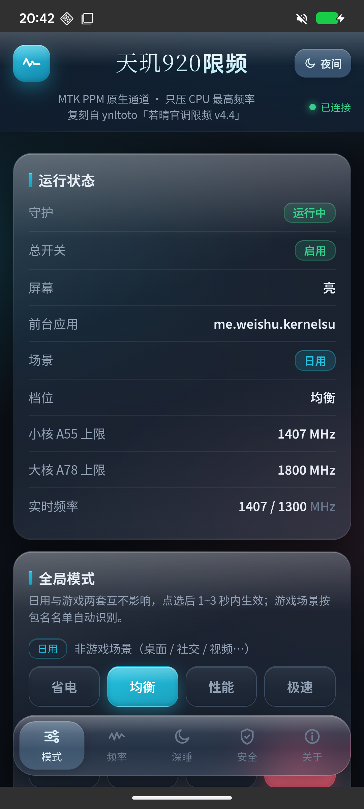
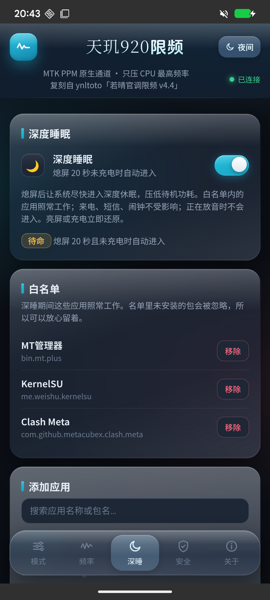
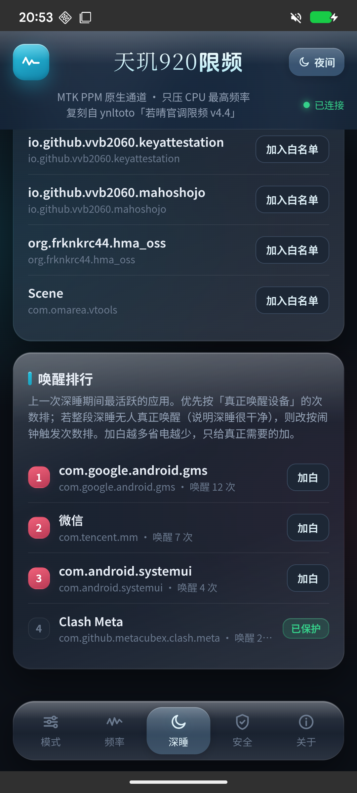

<div align="center">

# 天玑920限频 · mt6877_freq_cap

**Redmi Note 11 Pro+（天玑 920 / MT6877）的 CPU 上限管理模块 · KernelSU**

只压 CPU 最高频率 · 走 MTK PPM 原生通道 · 不改调度器、不改电压

日用 / 游戏双场景自动切档 · 每档频点可自定义 · 熄屏自动解锁 · 深度睡眠


</div>

---

## 这是什么的移植？

**作者：fenghao　改编自：ynltoto「若晴官调限频 v4.4」**

原作面向高通骁龙 8 至尊版（SM8750 / SM8850），本模块把同一套功能模型移植到天玑 920 上——
控制通道、参数语义、守护逻辑与整个 WebUI 都是重写的。

| 部分 | 来源 |
|---|---|
| CPU 限频 / 场景切换 / 档位 | 功能模型来自原作，**控制通道换成 MTK PPM** |
| 深度睡眠 | 逻辑复刻自原作（从其 `scripts/elite-freq` 的对外行为与数据契约反推） |
| WebUI | 视觉语言参照原作若晴模块，代码全新编写 |
| `config/games.list`、`sepolicy.rule` | **沿用原作** |

> 可以随意下载、修改、使用。

---

## 功能一览

| 功能 | 说明 |
|---|---|
| **双场景自动切档** | 守护每 3 秒巡检前台应用，自动判定「日用 / 游戏」，各用一套档位 |
| **四档 × 双场景** | 省电 / 均衡 / 性能 / 极速，日用与游戏互不影响 |
| **档位表覆盖** | WebUI 上直接改 4 档 × 日用/游戏 × 小核/大核 共 16 格频点 |
| **全局自定义频率** | 用一个开关接管全部场景的上下限，优先级最高 |
| **熄屏自动解锁** | 熄屏即把两簇写回不限，完全交还系统调度；亮屏重新限频 |
| **深度睡眠** | 熄屏未充电未放音满 20 秒自动接管系统 Doze，亮屏 / 充电 / 放音立即逐项还原 |
| **开机提速** | 系统开机后约 100 秒内按「极速」运行，避免开机卡顿 |
| **热重载** | 改配置文件后 3 秒内自动生效，无需重启 |
| **WebUI** | 玻璃拟态界面、日间/夜间双主题、5 个页签，全部操作点一下即生效 |

### 四档频率表（MHz）

| 档位 | 小核 A55 日用 | 大核 A78 日用 | 小核 A55 游戏 | 大核 A78 游戏 |
|---|---|---|---|---|
| 省电 | 1150 | 1540 | 1310 | 1800 |
| 均衡 | 1407 | 1800 | 1600 | 2000 |
| 性能 | 1600 | 2000 | 1800 | 2275 |
| 极速 | 1800 | 2275 | 2000 | 2500 |

全部取自本机 `scaling_available_frequencies` 的真实频点，写入后由内核自动对齐到 OPP 档位。

---

## 截图

<div align="center">

| 模式页 | 深睡页 | 唤醒排行 |
|---|---|---|
|  |  |  |

</div>

---

## 实测环境

| 项 | 值 |
|---|---|
| 机型 | Redmi Note 11 Pro+（`pissarropro`） |
| SoC | MediaTek 天玑 920（MT6877）· 6×Cortex-A55 + 2×Cortex-A78 |
| 系统 | Android 16 · crDroid 16.0（`BP3A.250905.014`） |
| 内核 | 4.14.357-Hydrogen |
| Root | KernelSU |
| 集群 | cluster0 = A55 500–2000 MHz · cluster1 = A78 650–2500 MHz |

> 只在上述环境实机验证过。其它 MT6877 机型理论上可用，但节点与 OPP 表可能不同，**刷入前请先确认自己的频点表**。

---

## 安装

1. 下载 [Releases](../../releases) 里的 `mt6877_freq_cap_v1.2.3.zip`
2. KernelSU 管理器 → 模块 → 从本地安装 → 选这个 zip
3. **重启手机**（KernelSU 装完必须重启才真正生效，否则 `modules` 和 `modules_update` 会同时存在两个版本）
4. 重启后在 KernelSU 管理器点本模块的「打开 WebUI」开始配置

卸载同样走 KernelSU 管理器，见[卸载与残留](#卸载与残留)。

---

## 使用

### WebUI（推荐）

底部五个页签：

| 页签 | 能做什么 |
|---|---|
| **模式** | 查看运行状态（守护 / 屏幕 / 前台应用 / 场景 / 档位 / 两簇上限 / 实时频率）+ 日用与游戏各四档，点选 1~3 秒生效 |
| **频率** | 全局自定义频率（开关 + 四格选择器）；档位表 16 格，点任意一格即可改 |
| **深睡** | 深度睡眠总开关 + 白名单增删 + 应用搜索 + 唤醒排行 |
| **安全** | 立即恢复不限 / 停用·恢复限频 / 重启守护 / 停守护并恢复 |
| **关于** | 原理、约定、致谢 |

右上角可切「日间 / 夜间」主题。

### 命令行

```sh
M=/data/adb/modules/mt6877_freq_cap/scripts/ctl.sh

sh $M status                    # 查看状态
sh $M dryrun                    # 只计算不写入
sh $M mode daily balance        # 切到日用·均衡
sh $M restore                   # 恢复不限
sh $M disable                   # 停用限频
sh $M enable                    # 恢复限频
sh $M apply                     # 按当前设置重新接管一次
sh $M ds on|off|status          # 深度睡眠开关
sh $M ds enter|exit             # 立即进入 / 退出深睡
sh $M dswhite list              # 深睡白名单
sh $M dswhite add com.tencent.mm
```

### 无 WebUI 时：音量键

音量 **+** 切档（先选日用/游戏，再选档位），音量 **−** 卸载并恢复。

---

## 深度睡眠

> v1.2.0 新增，逻辑复刻自原作若晴 v4.4。**默认关闭**，在 WebUI「深睡」页开启。

**触发条件**：熄屏 && 未充电 && 未放音，且持续 `grace` 秒（默认 20 秒）

**进入时做的事**（接管系统 Doze）：

1. 白名单里的应用 → **加入**系统 Doze 白名单（熄屏后照常工作）
2. 其余「用户级」白名单应用 → **移出**（强迫它们一起进 Doze）
3. 写入更短的 `device_idle_constants`（把进入深度空闲的等待从分钟级压到秒级）
4. `cmd deviceidle force-idle` → 直接强制进入 deep idle

**什么时候还原**：亮屏 / 插上充电器 / 开始放音 / 关闭深睡开关 / 停守护 / 卸载模块 / 重新开机

**还原方式**：白名单逐项比对回滚（自己加的移除、自己移出的加回），`device_idle_constants` 回到原值。

**不会影响的东西**

- 系统自带的 `system` / `system-excidle` 白名单（来电、短信、闹钟、IMS…）**一律不动**
- 白名单（含默认的微信、QQ）在深睡期间照常工作
- 充电中、正在放音时不会进入

**唤醒排行**：解析 `dumpsys alarm` 的 Alarm Stats 逐包做差，分 `wakes`（真把设备叫醒）与 `alarms`（闹钟被触发）两个口径，
优先用 `wakes`；整段深睡 `wakes` 全为 0 时回退 `alarms`（说明深睡很干净，闹钟都在设备本已清醒时批处理掉了）。
WebUI 会标明当前口径。

**安全兜底**：`device_idle_constants` 与 Doze 白名单是**持久化**数据，所以接管前会把原值与改动清单落盘到
`ds/saved.conf`，`uninstall.sh` 与 `service.sh`（开机）都会照快照补还原——断电、强杀、卸载都不会留下「系统一直过度休眠」。

> ⚠️ 别和系统自带的「省电模式 / 极致省电」叠加太久：两者都压后台，同时开会把消息推送也压住。要收微信就把微信加进白名单。

---

## 配置文件

目录：`/sdcard/Android/mt6877_freq_cap/`

| 文件 | 说明 |
|---|---|
| `mode.conf` | `mode_daily` / `mode_game`（当前场景所选档位） |
| `custom_freq.conf` | `ENABLE=1` 后填 `LITTLE/BIG × DAILY/GAME`（kHz）。`0` / `-1` = 该簇不限；留空或非数字 = 视为没配，回退档位表 |
| `tier_freq.conf` | 档位表覆盖。键名全大写 `<档位>_<LITTLE\|BIG>_<DAILY\|GAME>`，缺省项用内置预设 |
| `mygames.list` | 自己补的游戏包名，一行一个 |
| `dsleep.conf` | `enable=0/1` · `whitelist=包名,包名` · `grace=熄屏宽限秒` |
| `ds/` | 深睡运行目录（`active` / `saved.conf` / `alarm.base` / `wake.tsv`），自动维护 |

**优先级**：全局自定义 > 档位表覆盖 > 内置预设表 > 硬件最大值

---

## 与原型的关键差异

移植到天玑平台不是改个节点名就完事，有三个必须处理的差异：

### 1. 控制通道完全不同（最关键）

- 高通版：写 `/sys/devices/system/cpu/cpufreq/policyX/scaling_max_freq`
- 天玑版：该节点会被 **MTK PPM 引擎实时覆盖**（实测写入后立刻弹回硬件最大值），必须改走原生通道：

```
/proc/ppm/policy/cluster_0_max_freq    # A55 小核簇
/proc/ppm/policy/cluster_1_max_freq    # A78 大核簇
```

写入 kHz 值，内核自动对齐到真实 OPP 档位，因此不可能写入非法频点。

### 2. 「0」的含义不同（重大陷阱）

高通版约定 `0` = 硬件最大值。**在这个通道上写 `0` 会被内核解释成最低档**（实测 → 650 MHz），
直接写 0 等于把 CPU 压到最低频，手机会卡到不可用。

本模块已做防护：最终写入前 `0` / 负数 / 非数字一律转成 `-1`（不限）。**只有 `-1` 才是真正的「不限」**，卸载与恢复都写 `-1`。

### 3. 节点读回的不是 kHz，而是 OPP 降序索引

`/proc/ppm/policy/cluster_N_max_freq` 读回来的是「该簇 OPP 表的降序索引」，不是频率：

| 簇 | 索引 0..15 |
|---|---|
| A55 (cluster0) | 2000 1903 1800 1703 1600 1503 **1407** 1310 1260 1150 **1053** 980 900 740 650 500 (MHz) |
| A78 (cluster1) | 2500 2400 2275 2150 **2000** 1900 **1800** 1660 1540 1430 1300 1140 1040 910 740 650 (MHz) |

`-1` 仍表示「不限」。模块内部的 `ppm_khz()` 负责换算，
`ctl.sh status` 与 WebUI 显示的都是换算后的 MHz；`state.conf` 里 `c0_hz`/`c1_hz` 是换算值、`c0_now`/`c1_now` 是原始索引。

### 未移植的部分

- **刷新率管理**：骁龙版用 SurfaceFlinger `service call 1035`，天玑不适用 → 不做
- **智能校准学习**：原作由其闭源二进制实现 → 不做
- **GPU 限频**：本机 `/proc/gpufreq` 只有开关式接口，无法安全设置任意上限 → 不做

---

## 安全设计与恢复

- 只在开机后写 **runtime 的 `/proc` 节点**，不碰 boot / vendor 分区
  —— **重启即清空全部限制**，结构上不存在「刷入后无法开机」的可能
- 所有写入值先做数字校验，再钳制到 `[cpuinfo_min_freq, cpuinfo_max_freq]`，最后交给内核对齐到真实 OPP
- 守护进程启动失败时，`service.sh` 会自动把两簇恢复为 `-1`，不会留下半吊子限制

**恢复四招（任选）**

1. **运行时**：WebUI 点「立即恢复不限」或「停用限频」；也可在配置目录建一个名为 `disable` 的空文件
2. **ADB**：
   ```sh
   adb shell su -c "echo -1 > /proc/ppm/policy/cluster_0_max_freq; echo -1 > /proc/ppm/policy/cluster_1_max_freq"
   ```
3. **模块级**：KernelSU 管理器移除本模块并重启（`uninstall.sh` 会自动写回 `-1`）
4. **全局级**：创建 `/data/adb/modules/.disable_modules` 后重启 → 禁用所有模块

---

## 卸载与残留

走 KernelSU 管理器卸载**是干净的**，已在真机逐项核对（含「深睡激活中卸载」这种最脏的场景）：

| 检查项 | 结果 |
|---|---|
| 模块目录 + `modules_update` 副本 | 已删除 |
| 守护进程 | 归零 |
| PPM 两簇上限 | 都回 `-1` |
| Doze 白名单 | 29 条全量比对 **100% 一致** |
| `device_idle_constants` | 回到 `null` |
| `force-idle` | 已解除 |
| `state.conf` / `cmd` / `daemon.pid` / `disable` | 全部清除 |
| `/sdcard/Android/mt6877_freq_cap/` | **保留 5 个配置文件**（有意保留，重装可沿用） |

想连配置一起清干净：

```sh
rm -rf /sdcard/Android/mt6877_freq_cap
```

> ⚠️ **切勿绕过卸载脚本**（例如在文件管理器里直接删 `/data/adb/modules/mt6877_freq_cap`）。
> 已运行的守护进程**不会自己退出**，会继续把频率压在旧上限；深睡若正激活，缩短的
> `device_idle_constants`、`force-idle` 与改过的白名单会一并留下，而模块没了、开机也没人补还原。
>
> 补救三板斧后重启一次：
> ```sh
> su -c "echo -1 > /proc/ppm/policy/cluster_0_max_freq; echo -1 > /proc/ppm/policy/cluster_1_max_freq"
> su -c "settings delete global device_idle_constants"
> su -c "cmd deviceidle unforce"
> ```

---

## 常见问题

**Q：会和别的调度 / 调速模块冲突吗？**
会。请勿与其它调度调速工具同时使用（包括 `asoul_affinity_opt` 这类改调度的）。本模块只在官方 `schedutil` 之上管上限，叠加别人的调速会互相打架。

**Q：限频后卡顿？**
把该场景档位调高一档；或在「频率」页把对应值调到接近硬件最大值。

**Q：没生效？**
先 `ctl.sh status` 看守护是否运行、前台是否被识别；再 `ctl.sh dryrun` 看算出来的值。

**Q：开机后一段时间频率特别高？**
这是**开机提速**：系统开机后约 100 秒内（`/proc/uptime < 100`）按「极速」运行，避免开机卡顿，之后自动恢复你的设置。
判定依据是系统开机时长，所以点「重启守护」或覆盖更新模块都不会触发。

**Q：「立即恢复不限」之后会不会自己又限回去？**
不会。它会**保持放开**（守护继续运行但不再限频），点任一档位按钮或切到游戏场景才重新接管。想持久停用请点「停用限频」。

**Q：游戏识别不准？**
按包名名单匹配（`config/games.list`，316 个），与横竖屏无关。漏掉的游戏把包名按行写进 `/sdcard/Android/mt6877_freq_cap/mygames.list` 即可。

---

## 项目结构

```
mt6877_freq_cap/
├── module.prop                  # 模块属性
├── customize.sh                 # 安装脚本
├── service.sh                   # 开机自启（含深睡残留补还原）
├── uninstall.sh                 # 卸载清理（含 Doze 快照回滚）
├── action.sh                    # 音量键动作
├── sepolicy.rule                # SELinux 规则
├── config/
│   ├── games.list               # 游戏包名名单（316 个）
│   └── mode.conf                # 默认场景档位
├── presets/
│   └── MT6877.conf              # 天玑920 频点预设
├── scripts/
│   ├── util.sh                  # 公共函数（PPM 读写、档位解析、配置读写）
│   ├── daemon.sh                # 守护进程：场景判定 → 写 PPM 上限
│   ├── dsleep.sh                # 深度睡眠：Doze 接管 / 还原 / 唤醒统计
│   ├── ctl.sh                   # 命令行控制台
│   └── apply_once.sh            # 一次性应用
├── templates/                   # 默认配置与使用说明
├── webroot/
│   └── index.html               # WebUI（单文件，无外部依赖）
└── docs/screenshots/
```

---

## 变更记录

### v1.2.3

第二轮审计，专治「改了不生效 / 生效慢」。**限频主逻辑仍未改动。**

1. **修复「写失败被当成成功，从此再也不补写」**（本版最严重）
   `ppm_set` 原本无条件 `return 0`，守护则「写完就记签名、值没变就不重写」。
   于是偶发的一次写入失败会被永久记住 —— 表现就是**改了档位却完全不生效，而且不会再自愈**。
   现改为：写入失败返回非 0，两簇**都成功**才记签名，否则下一轮重试。
2. **修复改配置时频率会瞬间跳一下**
   WebUI 写 `tier_freq.conf` / `custom_freq.conf` 用的是 `cat > 目标`（先截断成 0 字节再写），
   而守护每 3 秒读一次这两个文件 —— 撞上窗口就读到空文件、回退到预设，
   表现为刚改完频率突然跳到默认值、下一秒又跳回来。已全部改为 `.tmp` + `mv` 原子替换
   （`mode.conf`、`dsleep.conf` 同理）。
3. **修复深睡宽限期内「点了没反应」**
   `ds_off_tick` 原先在 `while` 里 `sleep` 到宽限期满（最长 20 秒），
   这段时间守护主循环根本转不起来，WebUI / CLI 下发的命令全部要等宽限结束才被处理。
   已改成非阻塞状态机（靠 `DS_SINCE` 跨轮计时），等待期间命令照常 3 秒内生效。
4. **修复场景切换慢一拍**
   `FG_TTL=4` 大于巡检间隔 3 秒，导致前台应用实际每两轮才识别一次，
   游戏 ↔ 日用的切换要多等一轮。已改为 2 秒，保证每轮都扫。
5. **修复按键操作改了游戏档却按日用档应用**
   `action.sh` 最后写死 `apply_once.sh daily`，用户明明选的是游戏档，
   却按日用档去应用，等于改完当场不生效。已改为应用刚改的那个场景。
6. 守护写 `state.conf` 前补一次 `mkdir`，避免配置目录被删后一直显示「未运行」却查不出原因。

### v1.2.2

一次完整的代码审计，修掉 10 处问题。**限频主逻辑一行未改。**

1. **修复「停用后深睡不还原」**（本版最严重）
   守护的「停用」分支排在屏幕判断之前，而 `ds_on_tick` / `ds_off_tick` 都在后面 ——
   深睡中按下「停用」会让 `force-idle` 与缩短过的 `device_idle_constants` 永久留在系统里，
   连亮屏都不会还原。而且设置里显示「已停用」，用户根本无从判断是谁干的。
2. **修复「无快照时误删用户的 `device_idle_constants`」**
   `ds_exit` 原本无论有没有接管快照都会执行 `settings delete global device_idle_constants`。
   一旦被误调用（例如 `ds/active` 残留而快照已丢），用户自己设的 Doze 常量就被永久抹掉。
   这与 `ds_cleanup` 承诺的「没有证据就不动它」自相矛盾，现已统一。
3. **修复「末尾无换行的命令被丢弃」**
   `while read -r line` 对「最后一行没有换行符」会返回非零并跳过该行，表现为命令完全没生效。
4. **修复命令文件读取竞态**
   原实现是「读完 → 处理 → 最后才清空」，读取到清空之间有较大窗口，期间追加的命令会被静默丢掉。
   改为先快照、立刻清空、再处理（`while` 必须重定向而非接管道，否则赋值全丢在子 shell 里）。
5. **修复 `ds_conf_set` 并非原子写**
   注释声称「原子替换」，实际是 `cat tmp > 目标` —— 目标会先被截断成 0 字节再写入，
   WebUI 恰好在这时读就会拿到空配置（开关 / 白名单突然全空）。已改为 `mv`。
6. **修复 `kill_daemon` 可能杀错进程**
   `/proc/PID/stat` 第 2 字段 `(comm)` 可能含空格，按空格切字段会让后面全部错位、ppid 取到别的值。
   实测本机 767 个进程里有 2 个触发（旧写法把 state 字符串当成了 ppid）。已改为先剥掉 `pid (comm) `。
7. **堵住 `get_tier` 的任意代码执行面**
   预设表原本是 `. "$PRESETDIR/$soc.conf"` + `eval`，而 `soc` 来自 `config/soc.override` 的
   文件内容且未做任何过滤 —— 写入 `../..` 就能让模块以 root 执行预设目录之外的任意文件。
   现改为：soc 收敛到 `[A-Za-z0-9_]` 白名单，预设表改用 awk 解析，不再 source / eval。
8. **修复 `is_game` 用了正则而非字面匹配**
   `grep -x` 会把包名里的 `.` 当成「任意字符」，`com.foo.bar` 能命中 `comXfooXbar`。已加 `-F`。
9. **修复数字校验过松**
   `case "$v" in ''|*[!0-9-]*)` 会把 `-`、`1-2`、`--` 判成合法数字并原样写进 `/proc` 节点。
   新增 `_is_int()` 做严格校验。
10. **修复 `action.sh` 仍用 `${0%/*}`** —— 其余 5 个入口脚本上一版已改，这里漏了。
11. **降低深睡期间的检测开销**
    深睡中每 3 秒跑一次完整的 `dumpsys media_session` 检测放音，光检测就吃掉省下来的电。
    现改为屏幕 / 充电每轮查、放音每 5 轮（约 15 秒）查一次。
12. **WebUI 指令下发增加字符白名单**
    指令最终拼进 shell 的 `echo '<cmd>' >> file`，掺进单引号就能拼出任意命令。
    现只放行 `[A-Za-z0-9_=.,+-]`（19 条正常指令实测全部通过，注入样本全部拒绝）。

### v1.2.1

1. **修复卸载路径依赖**：`uninstall.sh` / `service.sh` / `daemon.sh` / `ctl.sh` / `apply_once.sh`
   原先用 `${0%/*}` 或 `dirname "$0"/..` 解析自身目录，当脚本被以「不带斜杠的相对路径」调用时
   （例如 `cd` 到目录后执行 `sh uninstall.sh`）会算错 → `util.sh` 加载失败、`CF_DIR` 等变量全空
   → 所有清理**静默跳过，却仍打印 DONE 的假成功**。现统一改为 `cd` + `dirname` 取绝对路径，并双层回退。
2. **卸载顺序调整**：先停守护、再动系统状态。原先先还原后杀守护，中间几秒守护可能恰好判定熄屏并重新接管，把还原覆盖掉。
3. `ds_cleanup` 在「无接管痕迹」时也会解除 `force-idle`；依旧不碰 `device_idle_constants`（用户自己设过的值，没证据不能动）。
4. 卸载时一并清理 `daemon.pid`。
5. **限频逻辑与深睡判定逻辑一行未改。**

### v1.2.0

1. 新增**深度睡眠**：熄屏未充电且未放音满 20 秒自动接管系统 Doze，白名单应用照常工作，其余移出用户级白名单，
   写入短常量并 `force-idle`；亮屏 / 充电 / 放音立即逐项还原。**默认关闭。**
2. 新增**唤醒排行**：按 `dumpsys alarm` 计数差结算「上次深睡期间」各应用唤醒次数。
3. WebUI 增加第 5 个页签「深睡」（白名单增删 + 应用搜索 + 唤醒排行）。
4. 安全加固：接管前把原值与改动清单落盘（`ds/saved.conf`），`uninstall.sh` 与 `service.sh` 都会照快照补还原。
5. 未改动任何限频相关逻辑。

### v1.1.0

1. **移除「应用专属」功能**：取消按包名固定档位的机制，相应删除 `app_modes.conf` 模板、
   `util.sh` 的 `app_mode_of`/`APP_FILE`、守护里的查表分支、`ctl.sh status` 的相关显示，以及 WebUI 的「应用」页。
2. **WebUI 全面重做**：视觉与布局参照原作——玻璃拟态卡片、悬浮磨砂顶栏、底部页签玻璃坞、
   自绘「液态选择器」替代系统下拉、日间/夜间双主题、内置手写体标题；按钮统一为模块化组件。
3. 新增**档位表覆盖**：WebUI 上直接改 4 档 × 日用/游戏 × 小核/大核 共 16 格频点，改完立即生效。
4. 修复**重复守护**隐患：`daemon_pids` 原先只在 pidfile 失效时才全盘扫描，导致上一轮重启残留的守护永远杀不掉。
5. 修复**「点了档位没反应」**（本版最关键的 Bug）：`toast` 提示条淡出后只是 `opacity:0`，元素仍在原地，
   而 `.toast` 缺少 `pointer-events:none` → 在屏幕正中留下一条看不见的「点击死区」，
   正好压住「均衡 / 性能」两个档位按钮。修复：加 `pointer-events:none` + 淡出后清空文案。
   顺手加固：桥接层改为全局串行队列 + 失败重试一次；每个按钮都报告真实结果，不再假成功。
6. 修复**「运行状态偶发显示未运行」**：守护改为「写临时文件 + rename」原子发布；WebUI 侧加 260 ms 重读、
   缓存上一份成功结果、连续 3 次读空才判定未连接。
7. 修复 `__lastState` 未声明（首次读到空内容会抛 `ReferenceError` 导致脚本中断）。

### v1.0.1（相对 v1.0）

自定义频率完全失效（查询键名与配置键名不一致）· 填 `0` 被当成「没配置」· 「停用限频」后无法恢复 ·
「重启守护」按钮无效 · 每次重启都白送提速 · 档位按钮高亮失效 · 总开关状态靠猜 ·
「立即恢复不限」后守护立刻重新限频 · 杀守护时子进程清理命令写错 —— 共 10 项。

---

## 作者与来源

- **作者**：fenghao
- **改编自**：ynltoto「若晴官调限频 v4.4」

移植与新增代码：`scripts/` 全部脚本、`webroot/index.html`、安装与卸载脚本、
`presets/MT6877.conf`、`templates/` 文档。
沿用原作的文件：`config/games.list`、`sepolicy.rule`。

可以随意下载、修改、使用。

**免责声明**

本项目按「现状」提供，不附带任何明示或暗示的担保。修改 CPU 频率上限属于系统级操作，
使用前请确认你了解其后果并自行承担风险。作者不对设备损坏、数据丢失或任何间接损失负责。
